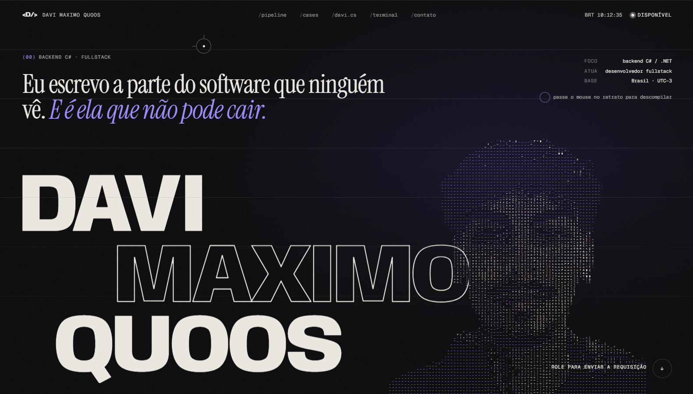

<div align="center">

<a href="https://davi.metup.com.br">
  
</a>

# Davi Maximo Quoos

**Desenvolvedor Fullstack · Backend C# / .NET**

*Eu escrevo a parte do software que ninguém vê. E é ela que não pode cair.*

<a href="https://davi.metup.com.br"></a>
<a href="https://www.linkedin.com/in/davimaximoquoos"></a>
<a href="mailto:devdavimaximo@gmail.com"></a>
<a href="https://wa.me/5551995204679"></a>

</div>

---

## `> whoami`

Sou desenvolvedor fullstack com o coração no backend. Construo **APIs em ASP.NET Core** com **Clean Architecture**, regras de negócio protegidas no domínio e dados que não se perdem, e subo até o pixel com **React** e **Three.js** quando a interface precisa estar à altura.

Hoje tenho **sistemas em produção** rodando com dados reais de clientes: SaaS multi-tenant de ERP + PDV, CRM comercial, gestão de creche e financeiro multiunidade. Trabalho na [Metup](https://metup.com.br).

```csharp
public sealed class Davi : IDeveloper
{
    public string Nome => "Davi Maximo Quoos";
    public Foco Foco => Foco.Backend | Foco.Arquitetura;

    public async Task<Software> ConstruirAsync(Ideia ideia, CancellationToken ct)
    {
        var dominio = await EntenderAsync(ideia, ct);  // primeiro o problema
        var nucleo  = Modelar(dominio);                 // regras sem framework
        return await EntregarAsync(nucleo, testes: true, ct);
    }
}
```

---

## `> anatomia de uma requisição`

Meu portfólio é uma viagem 3D por dentro de uma requisição HTTP, do Kestrel até o `200 OK`. Esse é o trace dela:




---

## `> tail -f /cases`



| Projeto | O que é | Stack |
|---|---|---|
| **Beemov** | SaaS de ERP + PDV multi-tenant para o mercado de bebidas. RBAC, auditoria e CI com 680+ testes | `.NET 10` `EF Core` `PostgreSQL` `React` |
| **Metup CRM** | Sistema operacional comercial: funil, atividades e API de ingestão idempotente | `ASP.NET Core` `SignalR` `Hangfire` |
| **Confraria** | ERP + PDV sob medida: caixa, estoque, PIX e cartão | `CQRS + MediatR` `PostgreSQL` `React` |
| **Sementinhas** | Gestão de creche com LGPD: permissão no servidor e auditoria de acesso sensível | `ASP.NET Core` `Identity` `React` |
| **Gestão Financeira** | Financeiro multiunidade com permissões por unidade e trilha de auditoria | `.NET 10` `Identity` `JWT` |
| [**Wedding Planner**](https://weddingplannerdn.vercel.app) | API que distribui o orçamento de casamento entre fornecedores | `ASP.NET Core` `Swagger` `React` |
| [**Xadrez Console**](https://github.com/devdavimaximo/Xadrez-Console) | Motor de xadrez do zero em C#: roque, en passant, xeque-mate | `C#` `.NET` |
| [**Caulim**](https://porcelana.metup.com.br) | Vaso em WebGL que atravessa torno, esmalte e forno conforme o scroll | `Three.js` `GLSL` `GSAP` |
| [**Fôlego**](https://apneia.metup.com.br) | Rolar a página é descer no mar: luz e pressão mapeadas à profundidade | `Three.js` `GLSL` `Lenis` |

> Os sistemas em produção não têm link público porque guardam dados reais de clientes. Mostro tudo funcionando numa call.

<div align="center">
  <a href="https://davi.metup.com.br">
    
  </a>
  <sub><b>↑ clique para abrir o portfólio, uma experiência WebGL em <a href="https://davi.metup.com.br">davi.metup.com.br</a></b></sub>
</div>

---

## `> dotnet list package`

**Backend**
<br />


**Arquitetura**
<br />


**Dados & Infra**
<br />


**Frontend**
<br />


---

## `> git log --graph`

<picture>
  <source media="(prefers-color-scheme: dark)" srcset="https://raw.githubusercontent.com/devdavimaximo/devdavimaximo/output/snake.svg" />
  <source media="(prefers-color-scheme: light)" srcset="https://raw.githubusercontent.com/devdavimaximo/devdavimaximo/output/snake-light.svg" />
  
</picture>

---

<div align="center">

**Tem um sistema que não pode cair?**

<a href="https://davi.metup.com.br"></a>

<sub>HTTP/2 200 OK · connection: keep-alive</sub>

</div>
